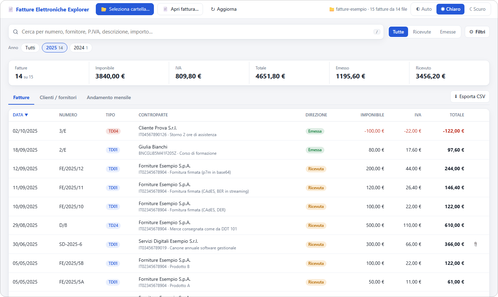
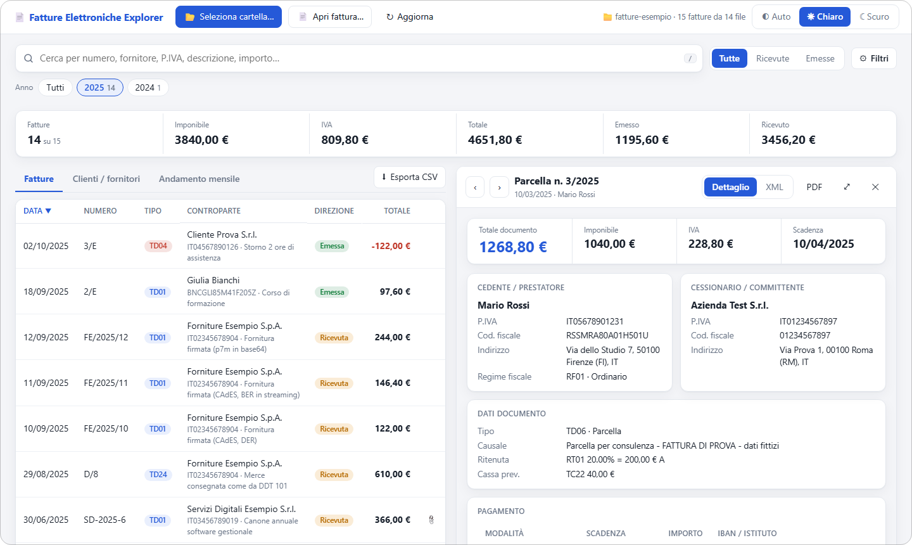
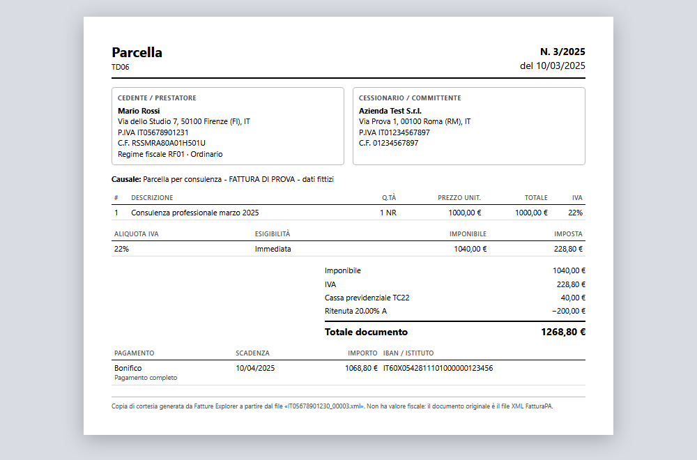

<div align="center">


# Fatture Elettroniche Explorer

**Esplora le tue fatture elettroniche italiane direttamente nel browser.**<br>
Cerca, filtra e leggi le fatture FatturaPA di una cartella del PC o del NAS: niente installazione, niente upload.

[](https://github.com/N1K1TAS95/fatture_elettroniche_explorer/actions/workflows/ci.yml)
[](https://github.com/N1K1TAS95/fatture_elettroniche_explorer/releases/latest)
[](LICENSE)
[](https://github.com/N1K1TAS95/fatture_elettroniche_explorer/commits/main)


[**Provala online**](https://fatture-elettroniche-explorer.n1k.cloud) · [Avvio rapido](#avvio-rapido) · [Caratteristiche](#caratteristiche) · [Pubblicarla su un server](#pubblicarla-su-un-server) · [Sicurezza](SECURITY.md)

<br>

[](https://fatture-elettroniche-explorer.n1k.cloud)

<a href="https://fatture-elettroniche-explorer.n1k.cloud">
<picture>
  <source media="(prefers-color-scheme: dark)" srcset="docs/screenshots/elenco-scuro.png">
  
</picture>
</a>

</div>

Esploratore leggero di **fatture elettroniche italiane** (FatturaPA, formato `.xml` e `.xml.p7m`). È una pagina web statica: scegli una cartella del PC o del NAS e naviga, cerca e filtra le fatture, senza installare nulla e **senza che i dati lascino il tuo computer**.

HTML, CSS e JavaScript puri, nessuna dipendenza, nessuna build, nessuna richiesta di rete. Può essere installata come **app (PWA)** e funziona anche offline.

## Demo online

Puoi provare l'app senza installare nulla su **https://fatture-elettroniche-explorer.n1k.cloud**: è la cartella `html/` di questo repository, pubblicata con GitHub Pages in HTTPS. Come sempre, le fatture le scegli tu dal tuo computer e **non vengono mai caricate**: l'app non fa nessuna richiesta di rete.

- Per provarla subito senza dati reali, scarica la cartella `tests/fixtures` (fatture fittizie) e aprila dall'app.
- La demo si aggiorna **solo quando viene pubblicata una release**: parte il workflow `.github/workflows/pages.yml`, che prima esegue i controlli e poi pubblica `html/` così com'è nel tag. Le modifiche non ancora rilasciate non compaiono online.
- GitHub Pages non permette di impostare header HTTP personalizzati: restano la Content-Security-Policy nel `<meta>` e l'assenza di richieste di rete, ma mancano gli header aggiuntivi di [nginx.conf](nginx.conf). Per un uso quotidiano con fatture vere conviene **la propria installazione** (vedi [Pubblicarla su un server](#pubblicarla-su-un-server)). Dettagli in [SECURITY.md](SECURITY.md).

## Avvio rapido

Scarica il repository e scegli un modo:

```bash
# 1. nessun server: apri html/index.html con Chrome o Edge
# 2. con un piccolo server locale (uv scarica da solo Python)
uv run serve.py        # poi apri http://localhost:8000
```

Clicca **Seleziona cartella…**, scegli quella delle fatture e inizia a cercare. Per provarla subito senza dati reali usa la cartella `tests/fixtures` (vedi [Fatture di prova](#fatture-di-prova)).

## Anteprima

<table>
  <tr>
    <td width="50%">
      <picture>
        <source media="(prefers-color-scheme: dark)" srcset="docs/screenshots/dettaglio-scuro.png">
        
      </picture>
    </td>
    <td width="50%">
      
    </td>
  </tr>
  <tr>
    <td align="center"><sub><b>Dettaglio</b> affiancato all'elenco, con tema chiaro, scuro o automatico</sub></td>
    <td align="center"><sub><b>PDF</b> della fattura, pronto da salvare o stampare</sub></td>
  </tr>
</table>

<sub>Schermate realizzate con le fatture fittizie di `tests/fixtures`.</sub>

## Indice

- [Demo online](#demo-online)
- [Avvio rapido](#avvio-rapido)
- [Anteprima](#anteprima)
- [Caratteristiche](#caratteristiche)
- [Usarla sul proprio computer](#usarla-sul-proprio-computer) (basta aprire `index.html`)
- [Pubblicarla su un server](#pubblicarla-su-un-server)
  - [Requisito: HTTPS](#requisito-https)
  - [Con Docker e Nginx Proxy Manager](#con-docker-e-nginx-proxy-manager-consigliato)
  - [Con Docker, senza proxy](#con-docker-senza-proxy)
  - [Con un altro web server](#con-un-altro-web-server)
  - [Riepilogo: cosa cambiare](#riepilogo-cosa-cambiare)
- [Installarla come app (PWA)](#installarla-come-app-pwa)
- [Privacy e sicurezza](#privacy-e-sicurezza)
- [Nota sul formato Assosoftware](#nota-sul-formato-assosoftware)
- [Fatture di prova](#fatture-di-prova)
- [Struttura del progetto](#struttura-del-progetto)
- [Sviluppo](#sviluppo)
- [Contribuire](#contribuire)

## Caratteristiche

- **Lettura ricorsiva di una cartella** (anche un'unità di rete o un percorso UNC) con barra di avanzamento. Gestisce `.xml` e `.xml.p7m` firmati (CAdES, anche in base64), più fatture in un solo file (lotti) e codifiche diverse da UTF-8.
- **Cerca** in un campo solo: numero, nome, P.IVA, codice fiscale, descrizione delle righe, causale, CIG/CUP, importo.
- **Filtri**: emesse/ricevute, anno, trimestre, mese, intervallo di date, cliente o fornitore, tipo documento, importo minimo e massimo. I filtri attivi sono mostrati come etichette.
- **La mia azienda**: la pagina riconosce la tua P.IVA e distingue fatture emesse (attive) e ricevute (passive). Le note di credito contano in negativo.
- **Tre viste**: elenco fatture, riepilogo per cliente/fornitore, andamento mensile (grafico a barre). Totali di imponibile, IVA e importo per quanto filtrato.
- **Dettaglio fattura** affiancato alla lista, o a tutta larghezza: anagrafiche, righe, riepilogo IVA, pagamento, ritenute, bollo, riferimenti (ordini, DDT, CIG/CUP), allegati (PDF apribili e scaricabili) e XML originale.
- **Fattura singola**: apri un solo file `.xml`/`.p7m` (o trascinalo sulla pagina) e leggilo a tutta pagina.
- **Recenti**: le ultime cartelle e fatture aperte si riaprono con un clic. Le fatture già lette sono tenute in cache, quindi la seconda apertura è molto più veloce, anche su NAS.
- **PDF della fattura** (copia di cortesia): il pulsante **PDF** del dettaglio apre un layout fattura pronto per la stampa su A4; nel dialogo di stampa del browser scegli *Salva come PDF*. Il nome del file proposto è `Fattura_numero_data_cedente`. Non ha valore fiscale: l'originale resta l'XML.
- **Esportazione CSV** di quanto filtrato (separatore `;`, decimali con la virgola, pronto per Excel).
- **Tema** automatico, chiaro o scuro. Interfaccia adattata a telefono, tablet, laptop e monitor molto larghi.
- Scorciatoie: `/` cerca, `←` `→` fattura precedente/successiva, `Esc` chiude.

### Browser supportati

| Browser | Selezione cartella e file | Recenti | Installazione come app |
| --- | --- | --- | --- |
| Chrome, Edge e derivati, da HTTPS o `localhost` | sì | sì | sì |
| Chrome, Edge e derivati, aprendo `index.html` da file | sì | non garantiti (dipende dal browser) | no |
| Firefox, Safari | modalità compatibile | no | no |

La *modalità compatibile* (pulsante che compare da solo) funziona in tutti i browser: si sceglie la cartella con il selettore standard, ma non vengono ricordate le cartelle recenti.

## Usarla sul proprio computer

**Non serve nessun server né nessuna installazione.**

1. Scarica o clona il repository.
2. Apri il file **`html/index.html`** con **Chrome** o **Edge** (doppio clic, oppure trascinalo nella finestra del browser).
3. Clicca **Seleziona cartella…** e scegli la cartella con le fatture (anche una cartella di rete del NAS), oppure **Apri fattura…** per una sola fattura.

Il browser chiede il permesso di leggere la cartella: l'accesso è in sola lettura. La cartella `html/` deve restare intera (`index.html` usa i file `app.css`, `app.js` e gli altri accanto a sé).

### Con un piccolo server locale (uv / Python)

Per avere **tutte** le funzioni (cartelle recenti garantite, installazione come app, stessi header di sicurezza della produzione) puoi servire l'app in locale con Python. Serve solo [uv](https://docs.astral.sh/uv/), che scarica da solo anche Python se manca:

```bash
uv run serve.py
```

Alla prima esecuzione uv crea l'ambiente virtuale (`.venv`) leggendo `pyproject.toml` (il progetto non ha dipendenze), avvia il server e apre il browser su `http://localhost:8000`. Per fermarlo: `Ctrl+C`.

| Opzione | Significato |
| --- | --- |
| `--port 9000` | usa un'altra porta (predefinita: 8000) |
| `--no-browser` | non apre il browser |
| `--host 0.0.0.0` | ascolta su tutta la rete locale. Dagli altri computer l'indirizzo è in HTTP, quindi la selezione delle cartelle non funziona (vedi [Requisito: HTTPS](#requisito-https)) |

Per creare solo l'ambiente, senza avviare nulla: `uv sync`. Senza uv basta qualsiasi Python 3.9 o superiore: `python serve.py`.

Aperta da file locale l'app funziona, ma **non può essere installata come app** (la PWA richiede un server, vedi sotto) e la memoria delle cartelle recenti e della cache dipende dal browser: se non è disponibile, l'app funziona ugualmente, semplicemente le cartelle vanno scelte ogni volta.

## Pubblicarla su un server

L'app è un sito statico: basta servire la cartella `html/`. Pubblicarla ha senso per averla sempre a disposizione da più computer, o per installarla come app.

> [!NOTE]
> Pubblicare l'app **non pubblica le fatture**: i file restano sul tuo computer o sul NAS e vengono letti dal browser di chi usa l'app. Il server consegna solo HTML, CSS e JavaScript.

### Requisito: HTTPS

> [!IMPORTANT]
> **Quando possibile, usa HTTPS.** Il browser abilita la selezione diretta di cartelle e file, la memoria delle cartelle recenti e l'installazione come app (PWA) soltanto in un *contesto sicuro*: **HTTPS** oppure `localhost`.

| Come raggiungi l'app | Selezione cartelle | Recenti | PWA |
| --- | --- | --- | --- |
| `https://fatture.miodominio.it` | sì | sì | sì |
| `http://localhost:8080` | sì | sì | sì |
| `http://192.168.1.10:8080` o `http://nas:8080` (HTTP, non localhost) | no, solo modalità compatibile | no | no |

Come ottenere HTTPS:

- **Nginx Proxy Manager** (consigliato, vedi sotto): certificato Let's Encrypt gratuito con un clic.
- **Accesso solo da rete interna**: usa un dominio tuo con un nome tipo `fatture.miodominio.it` che punta all'IP interno del server e chiedi il certificato con la *DNS challenge* di Let's Encrypt (Nginx Proxy Manager la supporta con molti provider DNS). Nessuna porta va aperta su Internet.
- In alternativa una CA locale (per esempio [mkcert](https://github.com/FiloSottile/mkcert)) con il certificato caricato nel proxy; i computer che usano l'app devono fidarsi della CA.

Attiva anche **HSTS** e il reindirizzamento da HTTP a HTTPS nel proxy.

### Con Docker e Nginx Proxy Manager (consigliato)

Il `docker-compose.yml` avvia un container `nginx:stable-alpine` che serve `html/`. Non pubblica nessuna porta: lo raggiunge solo il proxy, tramite una rete Docker condivisa. Nessuna build: i file sono montati in sola lettura, quindi una modifica a `html/` si vede subito.

**1. Prepara la configurazione** (opzionale se la tua rete si chiama `nginx-proxy-manager`):

```bash
cp .env.example .env
```

Modifica `.env` se serve (vedi la [tabella](#riepilogo-cosa-cambiare)):

```ini
PROXY_NETWORK=nginx-proxy-manager            # nome della rete Docker di Nginx Proxy Manager
CONTAINER_NAME=fatture_elettroniche_explorer   # nome del container (lo userai nel proxy)
```

Il nome della rete lo trovi con:

```bash
docker network ls
```

**2. Avvia:**

```bash
docker compose up -d
```

**3. Crea l'host in Nginx Proxy Manager** (*Hosts → Proxy Hosts → Add Proxy Host*):

| Campo | Valore |
| --- | --- |
| Domain Names | il tuo dominio, per esempio `fatture.miodominio.it` |
| Scheme | `http` |
| Forward Hostname / IP | il valore di `CONTAINER_NAME` (`fatture_elettroniche_explorer`) |
| Forward Port | `80` |
| Block Common Exploits | attivo |

Scheda **SSL**: scegli *Request a new SSL Certificate* (Let's Encrypt), attiva **Force SSL**, **HTTP/2 Support** e **HSTS Enabled**. Non servono *Custom Locations* né configurazioni avanzate: gli header di sicurezza li imposta già il container.

Se vuoi limitare l'accesso (per esempio alla sola rete locale) puoi usare una *Access List* di Nginx Proxy Manager.

**4. Apri** `https://fatture.miodominio.it`: l'app è pronta e, dal browser, installabile.

### Con Docker, senza proxy

Se non hai un reverse proxy, usa il file `docker-compose.standalone.yml`, che pubblica una porta:

```bash
cp .env.example .env     # poi modifica HOST_PORT e BIND_ADDRESS se serve
docker compose -f docker-compose.standalone.yml up -d
```

L'app risponde su `http://localhost:8080`. Con `BIND_ADDRESS=127.0.0.1` (predefinito) è raggiungibile solo dal computer stesso e, essendo `localhost`, **tutte le funzioni sono disponibili**. Con `BIND_ADDRESS=0.0.0.0` è raggiungibile da tutta la rete, ma in HTTP semplice dagli altri computer non funzionano selezione diretta delle cartelle, recenti e PWA (vedi [Requisito: HTTPS](#requisito-https)): metti un proxy con HTTPS davanti.

### Con un altro web server

Va bene qualunque server per file statici (nginx, Apache, Caddy, IIS…): copia la cartella `html/` nella sua radice, anche in una sottocartella (`https://miosito.it/fatture/`). Verifica questi punti:

- **HTTPS** attivo (vedi sopra).
- Il file `manifest.webmanifest` va servito come `application/manifest+json`.
- **`sw.js`** (il service worker) deve avere una Content-Security-Policy che consenta il `fetch` verso la propria origine, per esempio `default-src 'none'; connect-src 'self'`. Se riceve la stessa CSP restrittiva della pagina, il service worker non riesce a riempire la cache e l'app non è installabile.
- Consigliati gli header di `security-headers.conf` e la CSP di `nginx.conf` (che trovi commentata riga per riga) e `Cache-Control: no-cache`.
- Se aggiungi risorse da altre origini, aggiorna la CSP **sia** negli header **sia** nel `<meta http-equiv="Content-Security-Policy">` di `html/index.html`.

### Riepilogo: cosa cambiare

Con Nginx Proxy Manager e i valori predefiniti **non devi cambiare nulla nei file**: basta creare l'host nel proxy. Questi sono i parametri da adattare al tuo ambiente:

| Dove | Parametro | Predefinito | Quando cambiarlo |
| --- | --- | --- | --- |
| `.env` | `PROXY_NETWORK` | `nginx-proxy-manager` | Se la rete Docker del tuo proxy ha un altro nome (`docker network ls`). |
| `.env` | `CONTAINER_NAME` | `fatture_elettroniche_explorer` | Se vuoi un altro nome, o se hai più istanze. È l'host da inserire nel proxy (*Forward Hostname*). |
| `.env` | `HOST_PORT` | `8080` | Solo con `docker-compose.standalone.yml`: porta già occupata. |
| `.env` | `BIND_ADDRESS` | `127.0.0.1` | Solo con `docker-compose.standalone.yml`: `0.0.0.0` per aprirla alla rete locale. |
| Nginx Proxy Manager | Domain Names | — | Sempre: il tuo dominio. |
| Nginx Proxy Manager | Forward Hostname / Port | `CONTAINER_NAME` / `80` | Se hai cambiato il nome del container. |
| Nginx Proxy Manager | SSL, Force SSL, HSTS | — | Sempre: attivali (vedi sopra). |
| `nginx.conf` | `set_real_ip_from` (commentato) | disattivo | Solo se vuoi gli IP reali dei client nei log: metti la subnet della rete del proxy (`docker network inspect <rete>`). |
| `nginx.conf` | `Content-Security-Policy` | restrittiva | Solo se aggiungi risorse esterne (e allinea il `<meta>` di `index.html`). |
| `docker-compose*.yml` | `mem_limit`, `pids_limit` | `128m`, `100` | Praticamente mai: per un sito statico bastano. |
| `html/sw.js` | `VERSION` | numero progressivo | Dopo aver modificato i file dell'app: aumentala per ripulire la cache dei client. |
| `html/manifest.webmanifest` | `name`, `short_name`, colori | Fatture Elettroniche Explorer | Se vuoi un nome o un tema diversi per l'app installata. |

Le istruzioni sono riportate anche nei commenti dei file di configurazione, che non vanno altrimenti modificati.

## Installarla come app (PWA)

Pubblicata su **HTTPS** (o su `localhost`), l'app è una *Progressive Web App*: si può installare e si apre in una finestra propria, come un programma, anche **senza rete** (i file dell'applicazione vengono salvati dal browser; le fatture continuano a essere lette dalla tua cartella).

**Per installarla:**

- **Chrome / Edge (computer)**: clicca l'icona di installazione nella barra dell'indirizzo, oppure menu `⋮` → *Salva e condividi* → *Installa Fatture Elettroniche Explorer…* (in Edge: menu `…` → *App* → *Installa questo sito come app*).
- **Chrome (Android)**: menu `⋮` → *Installa app*.
- **Safari (iPhone/iPad)**: *Condividi* → *Aggiungi alla schermata Home*. Safari non supporta però la selezione diretta delle cartelle.

**Come funziona e cosa non fa:**

- Il service worker (`html/sw.js`) salva solo i file dell'app (HTML, CSS, JS, icone), con strategia *rete prima, cache se offline*: con la rete ricevi sempre la versione aggiornata.
- **Non salva mai le fatture** e non fa richieste verso altri siti.
- Da `file://` o da HTTP non-localhost il service worker non viene registrato: l'app funziona lo stesso, senza installazione.

**Aggiornare:** sostituisci i file in `html/`. Per essere sicuro che i client ripuliscano la vecchia cache, aumenta `VERSION` in `html/sw.js`.

**Rimuovere:** disinstalla l'app dal browser; per cancellare anche i dati salvati (cache delle fatture lette e recenti) usa *Impostazioni del sito → Cancella dati*.

## Privacy e sicurezza

- Le fatture sono lette **solo nel tuo browser**. L'app non effettua nessuna richiesta di rete: nessun server, nessuna telemetria, nessuna libreria o font esterno. La Content-Security-Policy lo impedisce anche a livello di browser.
- Le cartelle vengono aperte **in sola lettura**: l'app non scrive né modifica nulla.
- Per velocizzare le aperture successive, il browser conserva in locale (IndexedDB) i dati estratti dalle fatture (nomi, P.IVA, importi, descrizioni) e il riferimento alle cartelle recenti. Su un computer condiviso usa **Recenti → Svuota** o cancella i dati del sito dal browser.
- Il browser non rivela i percorsi completi dei file: l'app ricorda il nome della cartella e il permesso di accesso. Alla riapertura Chrome può chiedere di confermarlo.
- Le fatture contengono dati personali: **non caricarle mai in questo repository** (il `.gitignore` esclude `.xml`, `.p7m`, `.csv` e `.pdf`; l'unica eccezione sono le fatture fittizie di `tests/fixtures/`).

Il container è irrobustito (filesystem in sola lettura, `no-new-privileges`, capability ridotte, limiti di risorse, solo `GET`/`HEAD`, versione di nginx nascosta) e il server invia header di sicurezza e una CSP restrittiva. Dettagli, verifiche eseguite e come segnalare una vulnerabilità sono in [SECURITY.md](SECURITY.md).

## Nota sul formato Assosoftware

Assosoftware distribuisce un foglio di stile XSL gratuito per visualizzare le fatture, ma la sua [licenza](https://www.assosoftware.it/wp-content/uploads/2022/09/licenza_AssoInvoice_1.0.0.pdf) è proprietaria: consente di ridistribuirlo solo **senza modifiche** e vieta di riprodurlo o adattarlo. Per questo **non è incluso** in questo progetto (MIT) e il layout del PDF è stato scritto da zero. Chi lo desidera può usarlo per conto proprio scaricandolo da assosoftware.it.

## Fatture di prova

In `tests/fixtures/` ci sono fatture elettroniche **fittizie** (anche firmate `.p7m`, con allegato, lotti, note di credito, casi limite e un file con contenuto ostile per la sicurezza) per provare l'app senza usare dati reali. Scegli quella cartella con **Seleziona cartella…**; `tests/README.md` elenca cosa verifica ogni file e i risultati attesi. Non fanno parte del sito e non finiscono nel container Docker.

## Struttura del progetto

```
.
├── html/                        # il sito: è tutto ciò che va pubblicato
│   ├── index.html               # struttura della pagina
│   ├── app.css                  # stile (tema chiaro/scuro, layout responsive, stampa)
│   ├── app.js                   # lettura FatturaPA/P7M, filtri, viste, recenti
│   ├── theme.js                 # applica subito il tema scelto (evita il lampeggio)
│   ├── manifest.webmanifest     # manifest della PWA
│   ├── sw.js                    # service worker (installazione e uso offline)
│   ├── icon.svg
│   └── icons/                   # icone PNG della PWA
├── docker-compose.yml           # con reverse proxy (Nginx Proxy Manager)
├── docker-compose.standalone.yml# senza proxy, con porta pubblicata
├── .env.example                 # parametri di Docker da copiare in .env
├── .github/
│   ├── workflows/ci.yml         # controlli automatici (GitHub Actions)
│   ├── workflows/pages.yml      # pubblicazione della demo su GitHub Pages
│   ├── ISSUE_TEMPLATE/          # moduli guidati per segnalazioni e proposte
│   ├── PULL_REQUEST_TEMPLATE.md
│   └── dependabot.yml           # aggiornamento delle versioni delle Actions
├── docs/
│   ├── screenshots/             # immagini del README (fatture fittizie)
│   └── social-preview.png       # anteprima del link (da caricare nelle impostazioni del repository)
├── tests/
│   ├── fixtures/                # fatture di PROVA con dati fittizi
│   ├── generate_fixtures.py     # le rigenera: uv run tests/generate_fixtures.py
│   ├── check.py                 # controlli del repository: uv run tests/check.py
│   └── README.md                # cosa verifica ogni file, risultati attesi
├── pyproject.toml               # ambiente uv (nessuna dipendenza)
├── serve.py                     # server locale: uv run serve.py
├── uv.lock
├── nginx.conf                   # configurazione di nginx (commentata)
├── security-headers.conf        # header di sicurezza
├── .dockerignore                # esclude tests, ambiente Python e dati da eventuali build
├── AGENTS.md                    # istruzioni per gli assistenti di programmazione
├── CLAUDE.md                    # rimanda ad AGENTS.md
├── CHANGELOG.md
├── CONTRIBUTING.md
├── SECURITY.md
├── LICENSE
└── README.md
```

## Sviluppo

Non serve alcuna build. Per provarlo in locale (anche la PWA funziona, perché `localhost` conta come contesto sicuro):

```bash
uv run serve.py
```

`serve.py` serve `html/` con gli stessi header di sicurezza di `nginx.conf`. Se modifichi la CSP o i file dell'app, tieni allineati `serve.py`, `nginx.conf` e il `<meta>` di `html/index.html`.

Prima di committare puoi lanciare `uv run tests/check.py`: è lo stesso controllo che esegue la GitHub Action (CSP allineata, nessuna risorsa esterna, nessun dato in `html/`, PWA coerente). Dettagli in [tests/README.md](tests/README.md).

Il formato letto è FatturaPA 1.2.x (`FatturaElettronica`). Le fatture semplificate (`FatturaElettronicaSemplificata`) non sono supportate.

## Contribuire

Segnalazioni, idee e pull request sono benvenute: leggi [CONTRIBUTING.md](CONTRIBUTING.md). Una regola vale sempre: **non pubblicare mai fatture reali** (né in issue, né in screenshot), perché contengono dati personali e il repository è pubblico. Per le vulnerabilità usa la segnalazione privata descritta in [SECURITY.md](SECURITY.md).

## Licenza

[MIT](LICENSE).
